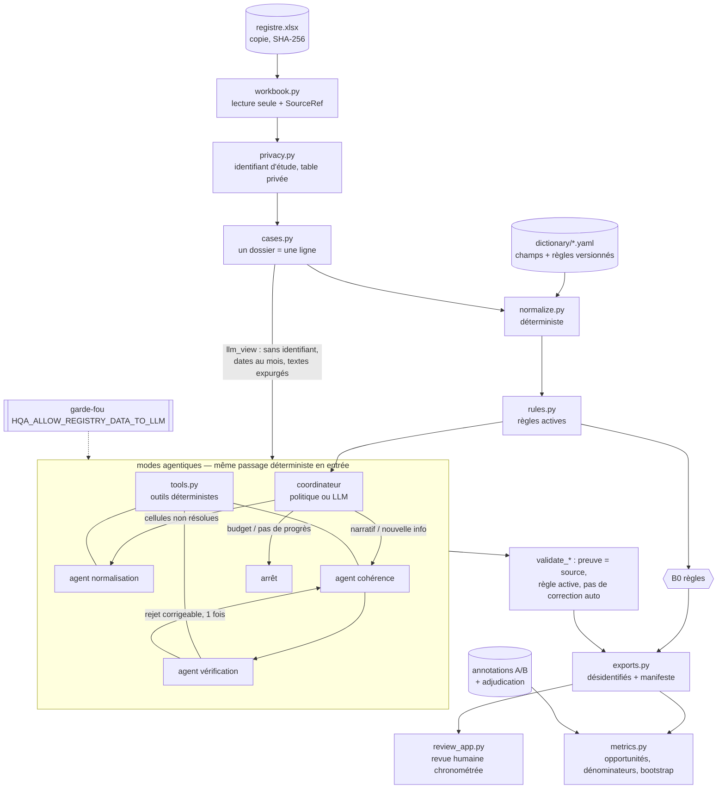

# Architecture

- **B1** agent unique avec boucle d'outils ; **B2** workflow fixe normalisation → cohérence → vérification
  sur toutes les cellules ; **B3** coordinateur adaptatif ; **B3-noverif** ablation sans vérificateur.
- Bornes : 2 normalisations, 1 révision, 6 appels et un budget de tokens par dossier, délai maximal, nombre limité
  de tentatives techniques, arrêt après absence de progrès. Une erreur technique ou une sortie invalide donne le
  statut `technical_failure`, jamais « aucune anomalie ».
- Les propositions sont des **actions de revue** ; le registre n'est jamais écrit.
