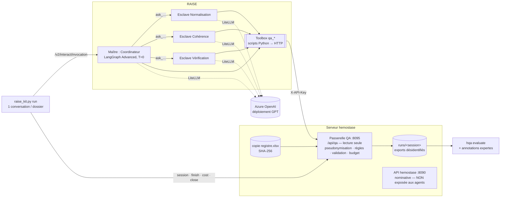

# Agents Maître/Esclaves RAISE pour le contrôle qualité du registre

Ce dossier contient les prompts et les définitions d'outils pour faire tourner le système multi-agent sur votre
plateforme RAISE (assistants LangGraph Advanced, délégation `delegate_assistant_ids`, modèles Azure OpenAI),
ainsi qu'un lanceur qui traite les dossiers un par un et produit des exports évaluables par `hqa evaluate`.

## 1. Principe : les agents n'appellent pas l'API 8090

L'API `http://<serveur>:8090/api` (FastAPI hemostase-py) ne convient pas aux agents :

| API 8090 `/api/fiches/...` | Risque si un agent GPT l'appelle |
|---|---|
| renvoie nom, n° de dossier, date de naissance complète | identifiants directs envoyés à Azure |
| `PUT` / `DELETE` sur les fiches | un agent peut modifier ou supprimer le registre |
| aucune validation métier des réponses d'agents | citations inventées, règles en hypothèse, corrections automatiques |

Les outils RAISE s'appuient donc sur une **passerelle QA** (`hqa/gateway.py`, port 8095). Son schéma OpenAPI est
publié sur `/api/qa/docs`. La passerelle :

- sert une vue **pseudonymisée** : identifiant d'étude, dates au mois, noms retirés des commentaires ;
- refuse de servir quoi que ce soit si `HQA_ALLOW_REGISTRY_DATA_TO_LLM` ne vaut pas `yes` ;
- est **en lecture seule** : aucune route n'écrit dans le registre ;
- **valide par code** chaque sortie d'agent : la preuve doit correspondre à la source, la règle doit être active,
  aucune précision inventée, censure conservée, aucune valeur complétée, action forcée à « review » ;
- **borne** le travail : 30 appels d'outils par dossier, 2 normalisations, 1 révision, 10 lectures ;
- compte tout dossier non terminé ou en erreur comme `technical_failure`, jamais comme « aucune anomalie » ;
- écrit les mêmes exports désidentifiés que `hqa run` (manifeste, journal de décision, anomalies), que `hqa evaluate`
  compare directement à B0–B3.

## 2. Architecture



Déroulé pour un dossier en RAISE-B3 :
1. Le lanceur ouvre une conversation et envoie `SESSION=… DOSSIER=S012` au Maître.
2. Le Maître lit le dossier et décide des étapes :
   - normalisation, seulement s'il reste des cellules non résolues ;
   - cohérence, seulement si le dossier contient un commentaire ou si une valeur nouvelle a été retenue ;
   - vérification, seulement s'il existe des candidates d'agent ;
   - au plus une révision.
3. Chaque Esclave lit le dossier, appelle les outils déterministes, puis soumet sa sortie à la passerelle. Il renvoie au Maître la réponse de la passerelle (retenu / rejeté).
4. Le Maître clôt le dossier avec `qa_terminer_dossier`. S'il ne le fait pas, le lanceur le clôt en `technical_failure`.
5. Le lanceur relève les coûts (`cost_tracking`). À la fin, il ferme la session, ce qui écrit les exports.

## 3. Deux façons d'utiliser Azure via RAISE

| | **Voie A — pipelines `hqa`** (recommandée pour les tableaux de l'article) | **Voie B — agents RAISE natifs** (ce dossier) |
|---|---|---|
| Orchestration | code Python `hqa` (B1, B2, B3, B3-noverif) | assistants RAISE Maître/Esclaves (LangGraph) |
| Accès au modèle | `/openai/v1` de RAISE → LiteLLM → Azure | assistants RAISE → LiteLLM → Azure |
| Bornes | exactes, dans le code | dans la passerelle (outils, soumissions) et dans les prompts (appels LLM) |
| Jetons | mesurés par appel | ceux de `cost_tracking` (à vérifier : inclut-il les Esclaves ?) |
| Configuration | `.env` uniquement | 6 assistants + 7 outils Toolbox |

Voie A, sans code supplémentaire :

```bash
# agentic-qa/.env
HQA_LLM_BASE_URL=https://<raise>/openai/v1      # sans « / » final
HQA_LLM_MODEL=<libellé du modèle Azure dans RAISE>
HQA_LLM_API_KEY=<clé API RAISE>
HQA_ALLOW_REGISTRY_DATA_TO_LLM=yes             # seulement après autorisation
docker compose run --rm hqa run --mode B3 --subset dev
```

Les deux voies s'évaluent avec les **mêmes annotations** et les mêmes métriques. Mon avis :
- les tableaux principaux de l'article devraient venir de la voie A, parce qu'elle est contrôlée et reproductible ;
- la voie B montre la même architecture sur une plateforme multi-agent de production ; elle peut faire l'objet d'une comparaison supplémentaire.

Correspondance des comparateurs :

| Article | Voie A | Voie B (RAISE) |
|---|---|---|
| B0 règles | `hqa run --mode B0` | identique, sans LLM (aussi présent dans chaque session : `deterministic_findings`) |
| B1 agent unique | `--mode B1` | assistant « Agent unique » → `RAISE-B1` |
| B2 workflow fixe | `--mode B2` | le lanceur appelle Normalisation → Cohérence → Vérification sans Maître → `RAISE-B2` |
| B3 adaptatif | `--mode B3` | Maître + 3 Esclaves → `RAISE-B3` |
| ablation | `--mode B3-noverif` | Maître sans Esclave Vérification → `RAISE-B3-noverif` |

## 4. Mise en place

### 4.1 Passerelle (serveur hemostase)

```bash
cd ~/NewReg/hemostase/agentic-qa
python3 -c "import secrets;print(secrets.token_urlsafe(32))"      # -> HQA_API_KEY dans .env
# .env : HQA_API_KEY=…  HQA_GATEWAY_BIND=127.0.0.1 (ou IP privée, voir 4.2)
#        HQA_ALLOW_REGISTRY_DATA_TO_LLM=yes   UNIQUEMENT après autorisation écrite (voir § 6)
docker compose build && docker compose up -d gateway
curl -s http://127.0.0.1:8095/api/qa/health
# schéma : http://127.0.0.1:8095/api/qa/docs
```

### 4.2 Réseau RAISE → passerelle

C'est le backend RAISE qui exécute les scripts de la Toolbox : c'est donc lui qui doit joindre la passerelle.

| Cas | `HQA_API_URL` (secret RAISE) | Publication de la passerelle |
|---|---|---|
| RAISE sur le même serveur, en Docker | `http://host.docker.internal:8095` (avec `extra_hosts: host-gateway`) ou l'IP du pont Docker | `HQA_GATEWAY_BIND=172.17.0.1` |
| RAISE sur un autre serveur | `https://qa.<domaine>` | proxy inverse HTTPS + liste blanche de l'IP de RAISE ; jamais `0.0.0.0` sans pare-feu |

### 4.3 Modèle Azure dans RAISE

Fournisseur Azure OpenAI dans l'administration RAISE. Le modèle s'appelle `azure/<nom-du-déploiement>`, avec
`api_base` et `api_version`. Réglez la **température à 0** dans chaque assistant.

### 4.4 Outils et prompts

```bash
python3 raise/raise_kit.py build          # -> raise/dist/ (prompts assemblés + toolbox_tools.json)
python3 raise/raise_kit.py register --raise-url https://<raise> --auth "Bearer <jeton admin>" \
        --hqa-url http://<passerelle vue depuis RAISE>:8095 --hqa-key <HQA_API_KEY>
```

`register` crée les 7 outils Toolbox et les secrets globaux `HQA_API_URL` et `HQA_API_KEY`. Ces secrets sont injectés dans le script et ne sont jamais visibles du LLM. Les identifiants des outils créés sont écrits dans
`raise/dist/toolbox_ids.json`.

### 4.5 Les 6 assistants (type « LangGraph Advanced », température 0)

| Assistant | Prompt système | Outils Toolbox (`selected_tool_ids`) | `delegate_assistant_ids` |
|---|---|---|---|
| QA Hémophilie — Normalisation | `dist/prompt_normalisation.txt` | qa_lire_dossier, qa_outil_deterministe, qa_soumettre_normalisations, qa_signaler_sortie_invalide | — |
| QA Hémophilie — Cohérence | `dist/prompt_coherence.txt` | qa_lire_dossier, qa_outil_deterministe, qa_soumettre_candidates, qa_signaler_sortie_invalide | — |
| QA Hémophilie — Vérification | `dist/prompt_verification.txt` | qa_lire_dossier, qa_outil_deterministe, qa_soumettre_verdicts, qa_signaler_sortie_invalide | — |
| QA Hémophilie — Coordinateur (B3) | `dist/prompt_coordinateur.txt` | qa_lire_dossier, qa_terminer_dossier, qa_signaler_sortie_invalide | Normalisation, Cohérence, Vérification |
| QA Hémophilie — Coordinateur sans vérificateur | `dist/prompt_coordinateur_noverif.txt` | idem | Normalisation, Cohérence |
| QA Hémophilie — Agent unique (B1) | `dist/prompt_agent_unique.txt` | les 7 outils | — |

La **description** de chaque Esclave devient la description de l'outil `ask_…` que lit le Maître. Copiez-la depuis
l'en-tête du fichier `prompts/2x_…md` ou `prompts/3x_…md` correspondant. Ne donnez aux Esclaves aucune base de
connaissances et aucun outil web : moindre privilège, et pas d'autre source que le dossier.

### 4.6 Essai puis exécution

```bash
# essai sur 2 dossiers dev
python3 raise/raise_kit.py run --system RAISE-B3 --subset dev --limit 2 \
   --raise-url https://<raise> --raise-auth <clé API RAISE> --hqa-key <HQA_API_KEY> \
   --master <id Coordinateur> --model azure/<déploiement> --prompt-version raise-v1
# puis les dossiers dev complets, pour chaque système
python3 raise/raise_kit.py run --system RAISE-B1 --subset dev --single <id> ...
python3 raise/raise_kit.py run --system RAISE-B2 --subset dev --normalizer <id> --coherence <id> --verifier <id> ...
python3 raise/raise_kit.py run --system RAISE-B3-noverif --subset dev --master <id sans vérificateur> ...
# test : seulement après « hqa split --freeze » et le gel des prompts (--prompt-version)
docker compose run --rm hqa evaluate --runs <B0> <RAISE-B1> <RAISE-B2> <RAISE-B3> <RAISE-B3-noverif> \
   --annotations data/derived/annotation_test_adjudicated.csv
```

## 5. Ce qui est garanti par le code et ce qui dépend du prompt

| Exigence | Garanti par la passerelle | Demandé dans le prompt |
|---|---|---|
| pas d'identifiant direct envoyé au modèle | ✔ vue pseudonymisée seulement | rappel |
| registre jamais modifié | ✔ aucune route d'écriture | rappel |
| preuve conforme à la source, règle active, pas de correction automatique | ✔ rejet ou conversion en « review » | ✔ |
| pas de précision inventée, censure conservée, valeur non complétée | ✔ | ✔ |
| un texte libre (« beaucoup ») lu comme un nombre | ✘ non détectable : reste une « proposition non validée par un expert » | ✔ |
| bornes : outils, normalisations, révision | ✔ HTTP 429 | ✔ |
| nombre d'appels LLM du Maître et des Esclaves | ✘ (côté RAISE) | ✔ + limite de récursion LangGraph |
| échec technique ≠ absence d'anomalie | ✔ dossier non clos = `technical_failure` | ✔ |
| décisions de routage réelles | journal de décision (quelles étapes ont été appelées) | ✔ |

## 6. À confirmer avant `HQA_ALLOW_REGISTRY_DATA_TO_LLM=yes`

- **Autorisation de traitement** des données pseudonymisées par un service cloud : DPO ou comité d'éthique, et l'autorité
  de protection des données compétente pour le registre. La pseudonymisation n'est pas une anonymisation.
- **Contrat et région Azure** : où est situé le déploiement, quel accord de traitement des données s'applique, et la conservation éventuelle des requêtes pour la surveillance des abus. Vérifiez les conditions de votre abonnement ; une rétention réduite se demande à Microsoft.
- **Journaux RAISE** : Langfuse, le journal fichier de LiteLLM et l'historique des conversations conservent la vue pseudonymisée. Il faut en définir la rétention et l'accès, ou désactiver ces journaux pour ces assistants.
- **Accès** : réservez ces assistants à un groupe restreint (partage RAISE / ABAC).

## 7. Points RAISE relevés dans votre version 1.8.4

1. **Lanceur Python de la Toolbox** : `input_data = {json.dumps(input_data)}` insère du JSON dans du code Python.
   Un argument `null`, `true` ou `false` provoque `NameError: name 'null' is not defined`. Je l'ai reproduit avec le
   gabarit exact. C'est pourquoi les outils fournis n'ont que des paramètres texte (les charges utiles passent dans
   `payload_json`). La correction en une ligne dans `core/use_cases/toolbox_use_case.py` :
   ```python
   input_data = json.loads({json.dumps(json.dumps(input_data))})
   ```
2. **Erreur d'un Esclave** : `dynamic_delegate_tool` renvoie un texte (« L'assistant délégué n'a pas pu répondre…
   répondez avec les informations disponibles ») au lieu d'une exception. Le prompt du Maître traite ce cas comme un
   échec, et le lanceur clôt en `technical_failure` tout dossier resté ouvert.
3. Un Esclave ne peut pas déléguer (`allow_delegation=False`) : c'est cohérent avec l'architecture à un niveau.
4. Les scripts de la Toolbox héritent de l'environnement du backend (`os.environ.copy()`). N'ajoutez que les scripts de ce kit, relus.
5. Vérifiez que `cost_tracking` de l'invocation du Maître inclut les appels des Esclaves. Sinon, prenez les coûts dans Langfuse ou dans la page de consommation, par conversation.

## 8. Limites

- Le nombre d'appels LLM et les jetons de la voie B dépendent de RAISE. La passerelle ne voit que les appels d'outils.
- La sortie du Maître n'est pas déterministe, même à température 0. Le manifeste trace le modèle et la version des prompts (`--prompt-version`), mais les prompts eux-mêmes se figent dans RAISE : exportez-les à chaque version.
- Les sessions de la passerelle sont gardées en mémoire. Un redémarrage pendant une session oblige à en ouvrir une nouvelle ; aucun export partiel n'est présenté comme complet.
- La passerelle lit la copie Excel du registre (empreinte vérifiée), pas la base de l'application 8090.
